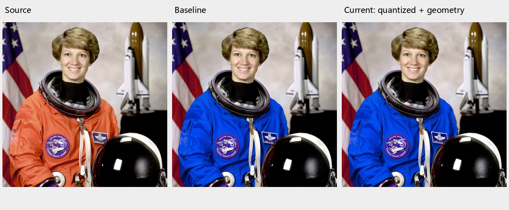

# AttrGuard-Edit

> 基于 Boogu-Image Edit 的参考图像编辑研究运行时：在扩散采样期间施加有界、可拒绝的属性保持反馈。

AttrGuard-Edit 是一个**以运行时代码为主**的研究快照。它保留 `boogu` 包名和序列化路径，以加载兼容的 Boogu-Image Edit 权重；除下方一张经审查的 README 展示图外，本仓库不包含基础模型权重、数据集、预测器权重、训练缓存或实验记录。

普通 `inference.py` 命令执行基础 Boogu-Image Edit。论文属性控制不是一个 CLI 开关：只有调用方构造固定的 `AttributeConstraints`，并通过 `inference.run(..., attribute_request=request)` 显式传入 `AttributeControlRequest` 时才会启用。

## 生成实例与边界



上图从左到右为源图、相同种子的基础 Edit 输出和当前属性控制输出。输入是 [scikit-image 提供的公开域 NASA astronaut 图像](https://scikit-image.org/docs/stable/api/skimage.data.html#skimage.data.astronaut)，编辑要求是将宇航服改为蓝色。两条生成分支的采样随机种子均为 `42`，参考图 VAE 随机种子均为 `43`；约束由人工在预处理后的源图坐标上对齐，当前分支采用 `feedback="local"`、`proposal_mode="quantized"`、`observer_profile="geometry"`。这是一条**机制诊断**记录：没有使用语义属性预测器，也不构成图像质量提升、泛化能力或论文指标复现的声明。

| 展示图 provenance | 记录值 |
|---|---|
| 编辑指令 | `仅将宇航员的橙色宇航服改为蓝色。保持人物面部、头发、宇航服结构与褶皱、所有徽章和标识、白色绑带、头盔、国旗及背景不变。` |
| 本地 checkpoint | `Boogu-Image-0.1-Edit-fp8-reuse` 节省磁盘的复用布局；权重未上传。本仓库支持的干净安装来源是下方[官方 FP8 Edit 完整 pipeline](https://huggingface.co/Boogu/Boogu-Image-0.1-Edit-fp8)，但这里不声称两者可做字节级互换。 |
| 推理参数 | `512×512`、BF16、Euler、25 steps、text/image/empty guidance=`4.0/1.0/0.0`、model CPU offload、`seed=42`、`reference_seed=43` |
| 固定约束 | 人工源图对齐；属性顺序为 color/structure/texture/glyph/pixel；scales=`(0.1,0.5,0.5,0.5,0.1)`，tolerances=`(0.015,0.03,0.03,0.03,0.015)`；这些是未校准诊断值。 |
| 输出校验 | baseline SHA-256=`f219680f…96b2`；controlled SHA-256=`22ac6a21…6d5`；仓库内三栏图 SHA-256=`48f39888…fc62`。 |

为遵守最小发布边界，仓库没有收入该案例的 mask、约束文件或运行日志，所以这张图可审计其公开来源和生成参数，但**不能仅凭本仓库独立复跑到同一像素结果**。下文 1K/50-step 命令是推荐的通用启动示例，不是这张 512/25-step 展示图的复现命令。

当前快照没有附带经过训练且独立校准的 semantic attribute predictor，也没有 PRI predictor。自动预测约束或 PRI 的路径因此不能开箱即用；仓库不会为不存在的权重提供虚构下载链接。

## 平台与硬件

- Python：`>=3.10,<3.13`。
- 标准非 FP8：支持代码声明的 `cpu`、`cuda`、`cuda:N`；推荐 NVIDIA CUDA。CPU 可运行但会非常慢，CLI 不支持 MPS。
- 原生 Windows：使用标准非 FP8 权重。本项目没有声明或验证 `triton-windows`。
- FP8：依赖 Triton；本包仅为 Linux x86_64 声明 Triton 依赖。WSL2 需要可用的 NVIDIA CUDA 透传。
- CUDA requirements 固定为 PyTorch `2.11.0`、torchvision `0.26.0`、torchaudio `2.11.0` 和 CUDA 12.8 wheels；主机 NVIDIA 驱动必须与其兼容。

[上游 Boogu 推理指南](https://github.com/boogu-project/Boogu-Image/blob/main/INFERENCE_GUIDE.md)在关闭本地 rewriter 时给出的近似显存如下。它们是上游参考测量，不是本快照对所有 GPU、分辨率和驱动的保证。

| 放置方式 | 上游近似显存 | 说明 |
|---|---:|---|
| 无 offload，非 FP8 | 约 40 GB | 最简单、速度通常最好 |
| `model_cpu_offload` | 约 21.9 GB | 速度/显存的平衡路径 |
| `group_offload` | 约 18–20.3 GB | 块级搬运，Linux/CUDA 更适合 |
| `sequential_cpu_offload` | 小于 2 GB | 最省显存，通常最慢且需要较大系统内存 |

三种 offload 最多启用一种；启用 offload 时 `--device` 必须是 `cuda` 或 `cuda:N`。权重下载本身约为标准版 38.6 GB、FP8 版 21.3 GB，另需预留 Hugging Face 缓存和输出空间。

## 从零开始

### 1. 克隆并创建环境

```bash
git clone https://github.com/haizhu12/AttrGuard-Edit.git
cd AttrGuard-Edit

conda create -n attrguard-edit python=3.12 -y
conda activate attrguard-edit
python -m pip install --upgrade pip
```

如果仓库保持私有，请先让 Git Credential Manager 或 GitHub CLI 完成该 GitHub 账户的认证；匿名克隆私有仓库会返回 404。

### 2. 安装依赖

先从 PyTorch CUDA 12.8 索引安装三件套，再从 PyPI 安装其余依赖：

```bash
python -m pip install -r requirements/torch2.11-cu128.txt
python -m pip install -e .
python -m pip install -U "huggingface-hub>=0.34,<2"
python -m pip check
```

`requirements/torch2.11-cu128.txt` 有意只包含 PyTorch 三件套；`torchao` 等包由 `pip install -e .` 从 PyPI 安装。

### 3. 验证 CUDA

```bash
python -c "import torch; print('torch=', torch.__version__); print('cuda wheel=', torch.version.cuda); print('cuda available=', torch.cuda.is_available()); print('gpu=', torch.cuda.get_device_name(0) if torch.cuda.is_available() else 'none')"
```

CUDA 推理前应看到 `cuda available=True`。若为 `False`，先检查 NVIDIA 驱动、WSL2 GPU 透传或是否误装了 CPU wheel。

### 4. 下载完整 Edit 权重

只需选择下面一个完整 pipeline；其中已经包含 `mllm`、processor、scheduler、transformer 和 VAE，**无需另外下载 Qwen 或 VAE**。

- [Boogu/Boogu-Image-0.1-Edit](https://huggingface.co/Boogu/Boogu-Image-0.1-Edit)，已核验 revision：`0cce2581de53bfdb5d67aa438e39c3d6e7556808`
- [Boogu/Boogu-Image-0.1-Edit-fp8](https://huggingface.co/Boogu/Boogu-Image-0.1-Edit-fp8)，已核验 revision：`98dad8c1c6ed02e5293f64433e7900fc6f3a4060`

以下使用固定 revision 的单行命令可直接在 PowerShell 或 Bash 中执行。标准版：

```bash
hf download Boogu/Boogu-Image-0.1-Edit --revision 0cce2581de53bfdb5d67aa438e39c3d6e7556808 --local-dir models/Boogu-Image-0.1-Edit
```

FP8 版（仅 Linux x86_64/兼容 WSL2）：

```bash
hf download Boogu/Boogu-Image-0.1-Edit-fp8 --revision 98dad8c1c6ed02e5293f64433e7900fc6f3a4060 --local-dir models/Boogu-Image-0.1-Edit-fp8
```

目录 basename 必须保持为合法的 Edit 名称；Base/Turbo 权重会被本项目主动拒绝。下载后应至少包含：

```text
models/
└── Boogu-Image-0.1-Edit[-fp8]/
    ├── model_index.json
    ├── mllm/
    ├── processor/
    ├── scheduler/
    ├── transformer/
    └── vae/
```

### 5. 准备输入

将至少一张可解码图片放到 `inputs/source.png`。当前标准运行时只接受图像编辑：每个样本必须有非空参考图；FAR 和属性控制进一步要求每个样本恰好一张参考图。

单参考图的默认路径会把实际生成画布对齐到参考图经过 `--max_input_image_pixels` 和 `--max_input_image_side_length` 预处理后的尺寸；`--height/--width` 不会强制把任意参考图改成该尺寸。若要严格使用 1024×1024 画布，请先将输入准备为 1024×1024，并确认像素/边长上限没有再次缩放它。

## 标准非 FP8 推理（Windows PowerShell）

`device` 环境变量必须在 Python 启动前设置，因为模型模块在导入/构造时会读取它；它应与 `--device` 保持一致。

```powershell
$env:device = "cuda:0"

python inference.py `
  --pretrained_pipeline_name_or_path "models/Boogu-Image-0.1-Edit" `
  --use_fp8_weights False `
  --input_image_paths "inputs/source.png" `
  --instruction "将目标对象改为棕色，并保持其余内容不变。" `
  --height 1024 `
  --width 1024 `
  --dtype bf16 `
  --scheduler euler `
  --num_inference_steps 50 `
  --text_guidance_scale 4.0 `
  --image_guidance_scale 1.0 `
  --seed 42 `
  --output_image_path "outputs/edit.png" `
  --enable_model_cpu_offload_flag True `
  --device $env:device
```

约 40 GB 以上显存可尝试删除 `--enable_model_cpu_offload_flag True` 让模型常驻。更低显存可改用 `--enable_sequential_cpu_offload_flag True`，但不要同时保留其他 offload 标志。

## FP8 推理（Linux / WSL2）

```bash
export device=cuda:0

python inference.py \
  --pretrained_pipeline_name_or_path models/Boogu-Image-0.1-Edit-fp8 \
  --use_fp8_weights True \
  --input_image_paths inputs/source.png \
  --instruction '将目标对象改为棕色，并保持其余内容不变。' \
  --height 1024 \
  --width 1024 \
  --dtype bf16 \
  --scheduler euler \
  --num_inference_steps 50 \
  --text_guidance_scale 4.0 \
  --image_guidance_scale 1.0 \
  --seed 42 \
  --output_image_path outputs/edit-fp8.png \
  --enable_model_cpu_offload_flag True \
  --device "$device"
```

FP8 loader 会从 `<pipeline>/transformer/` 加载非 safetensors 格式的量化 transformer，并使用 pipeline 内含的 FP8 MLLM。不要把 `--use_fp8_weights True` 与标准非 FP8 目录混用。显存充足时可删除上面的 model CPU offload；不要同时启用其他 offload 标志。

## 常用参数

下表默认值均来自当前 `inference.py`：

| 参数 | 默认值 | 说明 |
|---|---|---|
| `--pretrained_pipeline_name_or_path` | 必填 | 完整 Boogu-Image Edit/Edit-fp8 pipeline |
| `--input_image_paths` | 无 | 必须至少一张参考图 |
| `--instruction` | 内置中文示例 | 实际使用时应显式提供非空编辑指令 |
| `--output_image_path` | `output.png` | 输出文件；父目录自动创建 |
| `--device` | 必填 | `cpu`、`cuda` 或 `cuda:N` |
| `--dtype` | `bf16` | `fp32`、`fp16`、`bf16` |
| `--scheduler` | `euler` | `euler` 或 `dpmsolver++`；论文控制/FAR 要求 Euler |
| `--num_inference_steps` | `50` | 去噪步数 |
| `--height` / `--width` | `1024` / `1024` | 请求/回退尺寸；默认单参考图路径会改为预处理后的参考图画布 |
| `--seed` | `0` | 主噪声随机种子 |
| `--reference_seed` | 自动派生 | 独立参考 latent 随机种子；通常为 `seed+1`，当 `seed=2**63-1` 时回绕为 `0`；不可与 `seed` 相同 |
| `--text_guidance_scale` | `4.0` | 文本 CFG |
| `--image_guidance_scale` | `1.0` | 参考图 guidance |
| `--num_images_per_instruction` | `1` | 每条指令生成数量 |
| `--use_fp8_weights` | `False` | 仅与 Edit-fp8 pipeline 配套 |
| 三种 offload 标志 | `False` | 最多一个为 `True` |
| `--enable_torch_compile` | `False` | 首次编译慢；部分组合可能输出黑图 |

TeaCache、TaylorSeer 和 Cache-DiT 互斥，优先级为 Cache-DiT > TaylorSeer > TeaCache。先验证无加速基线，再一次只启用一种。

## 输出行为

- 单图：结果保存到 `--output_image_path`，终端打印 `Image saved to ...`。
- 多图：另存 `<stem>_0.<ext>`、`<stem>_1.<ext>` 等单图，并把横向拼图写入原始 `--output_image_path`。
- 父目录会自动创建；重用同一路径会覆盖已有文件。
- 复现时应记录精确 checkpoint revision、输入哈希、原始/负向/最终改写指令、所有有效参数、dtype、scheduler、步数、尺寸上限、guidance、offload/cache 状态、软硬件环境以及两个 seed；即使这些均相同，跨硬件也不保证逐位确定性。启用采样式本地改写或远程改写时，还必须冻结或保存最终改写文本。

## 论文属性控制：编程接口

普通 CLI 不会自动启用此方法。以下最小片段展示如何构造请求；它假设 `pipeline`、`args` 和 `source_image` 已按 `inference.py` 加载。示例中的矩形 mask、`scales=(1.0,)*5` 和 `tolerances=(0.05,)*5` 仅用于验证机制，**不是训练或独立校准得到的推荐参数**。

```python
from pathlib import Path

import torch
from boogu.attributes.constraints import AttributeConstraints
from boogu.attributes.control import ControlConfig
from boogu.attributes.runtime import AttributeControlRequest
from inference import run

max_pixels = pipeline._get_max_image_pixels(
    num_images=1,
    max_input_image_pixels=args.max_input_image_pixels,
)
source = (
    pipeline.image_processor.preprocess(
        source_image,
        max_pixels=max_pixels,
        max_side_length=args.max_input_image_side_length,
    ).float() / 2 + 0.5
).cpu()

h, w = source.shape[-2:]
edit = torch.zeros(1, 1, h, w)
edit[:, :, h // 3 : 2 * h // 3, w // 3 : 2 * w // 3] = 1
keep = (1 - edit).expand(1, 5, h, w).clone()

constraints = AttributeConstraints(
    source=source,
    keep=keep,
    edit=edit,
    scales=(1.0,) * 5,
    tolerances=(0.05,) * 5,
    provenance="manual_demo_mask",
)
request = AttributeControlRequest(
    constraints=constraints,
    config=ControlConfig(),
    operation="recolor",
    observer_profile="geometry",
)

result = run(
    args, pipeline, args.instruction, args.negative_instruction,
    input_images=[[source_image]],
    input_image_paths=[[args.input_image_paths[0]]],
    attribute_request=request,
)
Path(args.output_image_path).parent.mkdir(parents=True, exist_ok=True)
result.images[0].save(args.output_image_path)
print(request.diagnostics)
```

活跃属性控制要求：batch size 1、`num_images_per_instruction=1`、恰好一张参考图、Euler scheduler、同一预处理画布和固定源图约束；不得与 FAR、轨迹捕获、BOG、TeaCache/TaylorSeer/Cache-DiT 同用；只支持模型常驻或 model CPU offload，不能使用 sequential/group offload，也不能包在 `torch.inference_mode()` 中。支持的 `operation` 为 `recolor`、`replace_text`、`remove_text`。

`ControlConfig()` 的代码默认值为：`beta=0.05`、`kappa=0.1`、`local_kappa=0.2`、`start=0.35`、`end=0.85`、`interval=2`、`iterations=2`、`backtracks=3`、`step_size=0.25`、`regularization=0.01`、`edit_ratio=0.05`、`improvement_epsilon=1e-8`、`feedback="local"`、`lookahead_steps=1`、`proposal_mode="quantized"`。

可选桥接器 `utils/predict_attribute_constraints.py` 只接受另行提供的、具有 semantic trained/calibrated provenance 的 checkpoint，并要求 held-out calibration 参数。当前仓库未提供该权重，因此手工固定约束是唯一可立即审计的属性控制入口。

## FAR / 外部 PRI map（可选）

FAR 将每步编辑流和保留流按 P/R/I（Primary/Response/Invariant）区域组合。最直接的可复现方式是由调用方提供外部 PRI map：RGB 三通道依次表示 P/R/I，每个像素会归一化且不能全黑；也可提供仅含 `probabilities.npy` 的 NPZ，shape 为 `[3,H,W]` 或 `[1,3,H,W]`。

下面是 Linux/WSL2 的完整 FAR 命令，不是需要在 shell 中单独执行的参数片段：

```bash
export device=cuda:0

python inference.py \
  --pretrained_pipeline_name_or_path models/Boogu-Image-0.1-Edit-fp8 \
  --use_fp8_weights True \
  --input_image_paths inputs/source.png \
  --instruction '仅修改指定主体，并保持其余区域不变。' \
  --negative_instruction= \
  --dtype bf16 \
  --scheduler euler \
  --num_inference_steps 50 \
  --text_guidance_scale 4.0 \
  --image_guidance_scale 1.0 \
  --empty_instruction_guidance_scale 0.0 \
  --cfg_range_start 0.0 \
  --cfg_range_end 1.0 \
  --num_images_per_instruction 1 \
  --use_far True \
  --far_region_map_paths pri/sample.png \
  --far_invariant_strength 0.5 \
  --far_effect_strength 0.5 \
  --far_response_transport_mode analytic \
  --far_response_kernel_sizes 15 7 3 \
  --seed 42 \
  --output_image_path outputs/far-edit.png \
  --enable_model_cpu_offload_flag True \
  --device "$device"
```

FAR 默认使用 analytic multiscale transport：kernel `15,7,3`，中心 `0.0,0.5,1.0`，response strength `0.5`，invariant strength `0.5`。它要求关闭 rewriting、BOG、prompt tuning、LoRA 和所有 cache acceleration。

`--pri_predictor_checkpoint` 与 `--far_region_map_paths` 是互斥的 PRI 来源。仓库没有附带 PRI predictor checkpoint；其目录格式必须是 `current.json` 加 `generations/<32hex>/{metadata.json,predictor.safetensors}`，因此没有该外部权重时请使用显式 PRI map。

## 常见问题

| 症状 | 原因与处理 |
|---|---|
| `only accepts an Edit or Edit-fp8 checkpoint` | 目录 basename 不合法或传入了 Base/Turbo；使用上面的精确目录名，避免末尾空格。 |
| `every sample requires at least one reference image` | 缺少或传入空的 `--input_image_paths`。 |
| CUDA 算子未启用或异常缓慢 | 在 Python 启动前设置 env `device`，并确保与 `--device` 一致。 |
| `torch.cuda.is_available()` 为 `False` | 检查驱动、CUDA wheel、WSL2 GPU 透传和 `CUDA_VISIBLE_DEVICES`。 |
| FP8 assert、Triton 导入失败 | 使用了非 FP8 目录或原生 Windows；换成官方 FP8 目录并在 Linux x86_64/WSL2 运行。 |
| CUDA OOM | 一次只启用一种 offload；关闭 rewriter/cache/compile，保持 batch=1 和 1K，必要时使用 sequential offload。 |
| device/offload compatibility error | 启用了多个 offload，或 `--device cpu` 同时启用 offload。 |
| `seed and reference_seed must be independent` | 两个种子相同；删除 `--reference_seed` 或设为不同整数。 |
| 黑图 | 首先关闭 `--enable_torch_compile`；再关闭缓存加速并复测基线。 |
| FAR `exactly one PRI source` | PRI map 与 predictor 同时传入或都未传；只保留一个。 |
| PRI map 报 RGB/all-black | 使用真正 RGB 图片，保证每像素至少一个 P/R/I 通道非零。 |
| 属性控制报 identical canvas/source differs | 用 pipeline 对实际参考图的同尺寸 preprocess 构造 `source/keep/edit`，不要直接使用原图坐标。 |
| 属性控制报 cannot combine | 关闭 FAR、轨迹、BOG、全部 cache acceleration；使用 Euler 和单图。 |

## 安全、隐私与许可

- Pipeline loader 使用 `trust_remote_code=True`。只加载可信、已审计并固定 revision 的模型；恶意模型仓库可在推理进程中执行 Python。
- 若启用 DashScope 指令改写，通过环境变量 `DASHSCOPE_API_KEY` 提供密钥。原始和改写指令可能进入控制台或可选日志，应按敏感数据处理。
- 输入图、输出图、mask 和 diagnostics 可能包含敏感信息；本项目不会替你执行脱敏。
- 本组合运行时因包含 TaylorSeer 衍生组件按 GPL-3.0-only 分发。Apache-2.0、BSD-3-Clause 和 MIT 组件保留各自条款，详见 [NOTICE](NOTICE)、[LICENSE](LICENSE) 和 [LICENSES](LICENSES)。
- Boogu 模型权重不随本仓库分发；模型页将仓库标记为 Apache-2.0，但商业分发前仍应独立核查其内嵌组件的许可与来源。

## 验证边界

发布打包前，完整研究工作区于 2026-09-21 通过 1,781 项测试；这些测试、生成夹具和实验数据没有收入本运行时快照。请把本项目视为可审计的研究机制实现，而不是已验证的端到端语义编辑产品。
