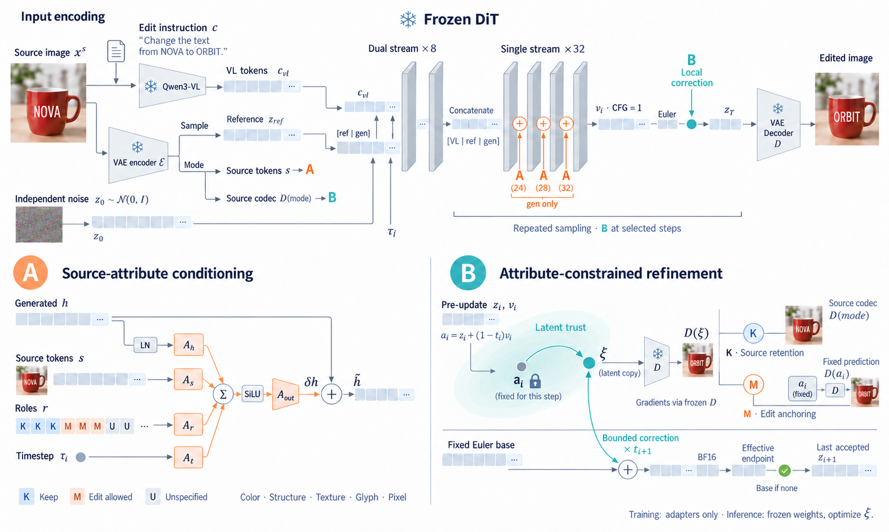

# AttrGuard-Edit: Instruction-Driven Image Editing with Attribute Permissions

<p align="center">
  Honggang Zhao<sup>a</sup>, Yi-jun Yang<sup>a,*</sup>, and Wei Zeng<sup>b</sup>
</p>

<p align="center">
  <sup>a</sup>School of Computer Science and Technology, Xi'an Jiaotong University, Xi'an, 710049, Shaanxi, China<br>
  <sup>b</sup>School of Mathematics and Statistics, Xi'an Jiaotong University, Xi'an, 710049, Shaanxi, China<br>
  <sup>*</sup>Corresponding author
</p>

[中文运行说明](README_CN.md)

## Abstract

Instruction-driven image editing aims to carry out natural language instructions while preserving unrelated content in the source image. Spatial masks can localize an edit, but different attributes at the same location may require different treatment. For example, recoloring a garment requires preserving its printed pattern and folds, yet a strong preservation constraint across the entire garment can suppress the intended color change. We propose AttrGuard-Edit, which uses externally supplied attribute permissions to guide both generation and inference-time correction. These permissions distinguish attributes that must be preserved from those that may change and leave the remaining attributes unspecified. During generation, a conditioning adapter injects source image features and attribute roles into the generator. During sampling, the model uses an autoencoder reconstruction of the source image as a reference to correct drift in attributes marked for preservation. For attributes permitted to change, the current prediction serves as an anchor during latent updates, limiting disruption to edits already made. In experiments on real photographs, AttrGuard-Edit met the joint criteria for edit completion, non-target content preservation, and visual naturalness more often than the baseline methods did. In the designated regions outside the edited object, the outputs closely matched the source image in pixel values, perceptual features, and local structure. The code is available at <https://github.com/haizhu12/AttrGuard-Edit>.

## Method Overview

[](assets/readme/paper-method-overview.png)

The same attribute permissions condition the generator alongside the source image and constrain latent optimization during sampling.

## Code Release

AttrGuard-Edit is a research runtime for editing an image while preserving attributes the instruction does not ask to change. Version 0.2.2 archives the current Full source-conditioned runtime, paired training, and opt-in frozen-weight inference controls. See [CHANGELOG](CHANGELOG.md).

The current method uses CFG=1 and skips the negative DiT branch at that setting. The Full architecture is unchanged. This release does not retrain the existing research adapter or establish general image quality.

## What you need

- Python 3.10–3.12 and a CUDA GPU with BF16 support.
- A complete, local standard Boogu Edit pipeline.
- A compatible Full adapter selected explicitly.
- One source image, an editing instruction, and source-bound per-attribute permissions.

There is no public trained AttrGuard adapter or automatic permission predictor in this repository. The current local research checkpoint received **96 updates on one real training photograph**. It is not a generally validated editing model. Base weights, research datasets and private checkpoints are not distributed with the code.

## 1. Install

Run these commands from your checkout. Existing configured environments can skip installation.

```bash
git clone https://github.com/haizhu12/AttrGuard-Edit.git
cd AttrGuard-Edit
conda create -n attrguard-edit python=3.12 -y
conda activate attrguard-edit
python -m pip install torch==2.11.0 torchvision==0.26.0 torchaudio==2.11.0 --index-url https://download.pytorch.org/whl/cu128
python -m pip install -e .
python -m pip install "huggingface-hub>=0.34,<2"
python -m pip check
python -c "import torch; print('CUDA:', torch.cuda.is_available()); print('BF16:', torch.cuda.is_available() and torch.cuda.is_bf16_supported())"
```

Both CUDA and BF16 must report `True` for the current method. The installation recipe is not a claim that a fresh installation has been tested on every platform. For portable FP8 installation, use Linux x86_64 or compatible WSL2: the package declares Triton only on Linux x86_64. An existing native Windows research environment is not a supported clean-install recipe for FP8.

## 2. Prepare the base weights

Choose one complete official pipeline:

| Base | Pinned revision |
| --- | --- |
| [Boogu-Image-0.1-Edit](https://huggingface.co/Boogu/Boogu-Image-0.1-Edit) | `0cce2581de53bfdb5d67aa438e39c3d6e7556808` |
| [Boogu-Image-0.1-Edit-fp8](https://huggingface.co/Boogu/Boogu-Image-0.1-Edit-fp8) | `98dad8c1c6ed02e5293f64433e7900fc6f3a4060` |

For the FP8 commands below:

```bash
hf download Boogu/Boogu-Image-0.1-Edit-fp8 --revision 98dad8c1c6ed02e5293f64433e7900fc6f3a4060 --local-dir models/Boogu-Image-0.1-Edit-fp8
```

The complete pipeline contains `model_index.json`, `mllm/`, `processor/`, `scheduler/`, `transformer/` and `vae/`. You do not need a separate Qwen or VAE download. Keep the Edit directory name; Base and Turbo checkpoints are rejected by this method.

For standard weights, use this download command instead, then select its path with `--use_fp8_weights False`:

```bash
hf download Boogu/Boogu-Image-0.1-Edit --revision 0cce2581de53bfdb5d67aa438e39c3d6e7556808 --local-dir models/Boogu-Image-0.1-Edit
```

## 3. Prepare the source, permissions and adapter

Save your photograph as `inputs/source.png`. Its width and height must be divisible by 16; inference preserves its canvas and does not resize it.

Create `inputs/permissions.npz` using the [permission file instructions](docs/source-conditioned-generation.md#permissions). Permissions have five separate attributes: color, structure, texture, glyph and pixel. They must come from the source image and editing instruction. Missing labels stay unknown.

Place your compatible adapter at `checkpoints/current/full_adapter.pt`, or change the path in the command below. If you have an older **Full research-format checkpoint**, export it explicitly:

```bash
python export_preservation_adapter.py --source path/to/full_research_adapter.pt --base-config models/Boogu-Image-0.1-Edit-fp8/transformer/config.json --output checkpoints/current/full_adapter.pt
```

Export requires a fresh destination and writes a `.pt.json` provenance record. It verifies that the adapter tensor values are unchanged; it does not train the model. Other ablation formats are not accepted. The `path/to/` input is your existing local checkpoint, not a file included with this repository.

To train a new Full adapter from reviewed real image pairs, follow the [training steps and data schema](docs/source-conditioned-generation.md#training). The training command exports the formal adapter directly.

## 4. Run the current method

Linux / WSL2:

```bash
export device=cuda:0
python inference.py \
  --method source-conditioned \
  --pretrained_pipeline_name_or_path models/Boogu-Image-0.1-Edit-fp8 \
  --use_fp8_weights True --dtype bf16 --device cuda:0 \
  --input_image_paths inputs/source.png \
  --instruction "Change only the jacket to blue; preserve everything else." \
  --preservation_adapter checkpoints/current/full_adapter.pt \
  --preservation_permissions inputs/permissions.npz \
  --scheduler euler --num_inference_steps 50 --text_guidance_scale 1 \
  --seed 42 --reference_seed 43 \
  --output_image_path outputs/my_edit_seed42.png
```

The instruction and permissions must describe the same edit. Use a fresh output name on every run. Success writes `outputs/my_edit_seed42.png` and `outputs/my_edit_seed42.png.json`; parent directories are created automatically.

`inference_ti2i_simple.py` forwards to this same CLI with 50 steps, CFG=1, seed=42 and CUDA defaults. Its default base path is the local research layout `models/Boogu-Image-0.1-Edit-fp8-reuse`; override `--pretrained_pipeline_name_or_path` for an official downloaded pipeline. It never selects a source, instruction, adapter or permission file for you.

See the [PowerShell example and troubleshooting guide](INFERENCE_GUIDE.md).

### Experimental keep routing (opt-in)

The runtime accepts `--preservation_keep_mode off|project|source-memory` with the same source-conditioned command above. The default remains `off`; existing adapters and base weights are unchanged.

- `project`: sampling-state protection for fully known pixel-keep patches; a spatial-control ablation.
- `source-memory`: the same protection plus source-feature routing through native double/single-stream blocks. Requires CFG=1 and an empty negative instruction; adds one unadapted source DiT forward per step when eligible patches exist.

Only full pixel-keep patches with no modify permission in **any** attribute are locked. Mixed/unknown patches and attribute-only keeps are not locked. This is inference-only and does not establish within-object attribute preservation, exact decoded RGB equality, or successful editing. It is neither RGB pasting nor a direct KV-Edit implementation. Read [experimental controls and limitations](docs/executable-keep-routing.md) before enabling it.

The October 7 controlled diagnostic completed 18 generations. Both enabled modes reduced protected-region error, but source-memory also suppressed a requested replacement and retained a ball requested for removal. Neither mode is promoted to the default; this is not a validated solution to general attribute preservation.

### Experimental latent optimization (opt-in)

Append these options to the source-conditioned command above:

```text
--preservation_optimization latent --preservation_edit_anchor attribute --preservation_keep_mode off --text_guidance_scale 1
```

This optimizes only the current image latent through the frozen FP32 VAE; no model weights are updated. Omit the options to keep optimization off. `--preservation_edit_anchor rgb` selects the earlier RGB anchor; `attribute` uses the explicit per-attribute permissions, with exact RGB fallback for pixel-only modify maps. Attribute mode requires latent optimization. It cannot be combined with keep routing, CFG other than 1, or legacy baseline.

The October 9 diagnostic found small preservation-proxy improvements on one dog recoloring case, but important fur/face differences remained. Five compatibility controls were unchanged. These are not evidence of general identity/structure preservation. The diagnostic used a separate existing MagicBrush pilot (9 training pairs, 96 updates), not the older one-photo adapter described above. Neither adapter is distributed. Read [usage and limitations](docs/inference-latent-optimization.md). Outputs from this diagnostic and private experiment helpers are excluded from the code archive.

## Scope and previous versions

The current method supports one image, one reference, an unchanged canvas, Euler sampling, BF16 computation and an FP32 VAE. Batch editing, canvas changes, FAR, legacy attribute corrections, cache acceleration, hook-based offloading and instruction rewriting are not supported in this path. Unsupported combinations fail before generation.

Use `--method baseline` explicitly for the previous Edit workflow, without preservation arguments. `inference_turbo.py` remains a separate legacy Edit-Turbo entry and cannot use this adapter. Historical NASA astronaut and synthetic examples, where retained in earlier releases, document earlier methods and are not evidence for 0.2.2 quality.

If your local Edit folder uses directory junctions, preserve their targets. In the research `*-fp8-reuse` layout, deleting `models/Boogu-Image-0.1-Turbo-fp8` breaks shared components.

## License

The combined distribution is GPL-3.0-only; component notices and their original licenses remain applicable. See [LICENSE](LICENSE), [NOTICE](NOTICE) and [LICENSES](LICENSES). Model weights are distributed separately by their owners.
